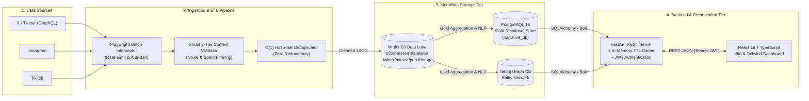
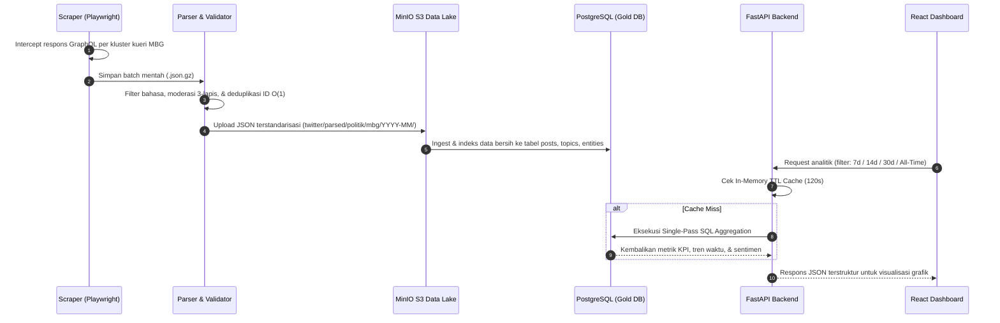
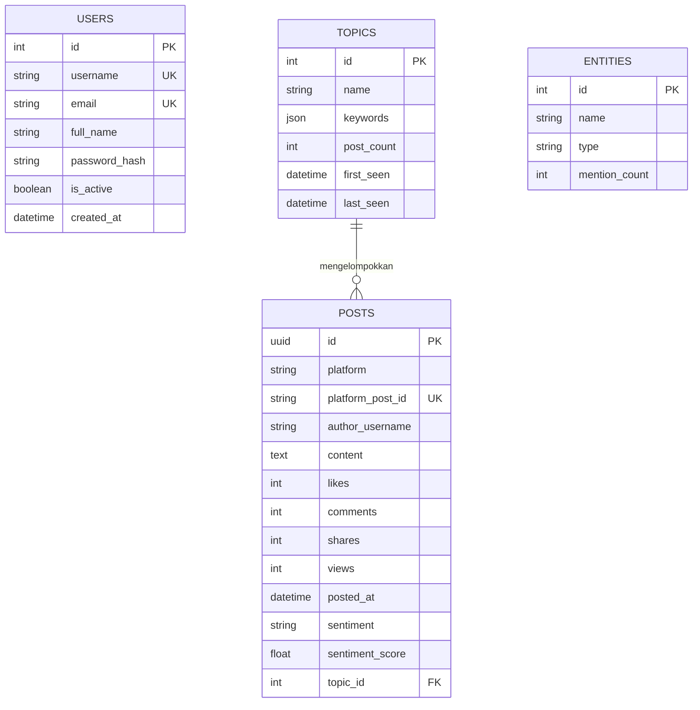

# Narrative Trend Dashboard


**Narrative Trend Dashboard** adalah platform *Social Media Intelligence & Narrative Analytics* berbasis arsitektur **Medallion Data Lakehouse**, **FastAPI**, dan **React TypeScript**. Sistem ini dirancang untuk memantau tren percakapan publik, dinamika sentimen lintas waktu, serta peta jejaring entitas (*Knowledge Graph*) secara terintegrasi dengan fokus studi kasus kebijakan publik **Program Makan Bergizi Gratis (MBG)**.

---

## Arsitektur Sistem (*System Architecture*)

Sistem mengadopsi pola arsitektur **3-Tier Distributed Data & Application Pipeline** yang memisahkan lapisan akuisisi data (*Ingestion*), penyimpanan terpusat (*Storage & Lakehouse*), serta layanan API & antarmuka visualisasi (*Serving & Presentation*):



---

## Alur Pemrosesan Data (*End-to-End Workflow*)



---

## Skema Basis Data Relasional (*Entity-Relationship Diagram*)



---

## Fitur Utama

* **Akuisisi & Pemrosesan Data Fokus Isu MBG (`scrapers/` & `pipeline/`)**
  * **Playwright Network Interceptor**: Menangkap trafik *GraphQL SearchTimeline* X/Twitter lintas kluster semantik (*Kebijakan & Anggaran BGN*, *Operasional Dapur SPPG*, *Keamanan Pangan & Evaluasi Menu*, serta *Pencegahan Stunting*) lengkap dengan *circuit breaker* HTTP 429.
  * **Smart 3-Tier Content Validator**: Menyaring spam, promosi ilegal, dan konten di luar konteks sebelum masuk ke *Data Lake*.
  * **Zero-Duplicate Guarantee**: Sinkronisasi dan deduplikasi ketat berbasis `post_id` pada bucket `s3://narative-datalake/twitter/parsed/politik/mbg/`.
* **Layanan Backend Berperforma Tinggi (`backend/`)**
  * **FastAPI & SQLAlchemy ORM**: Dirancang modular dengan migrasi skema otomatis berbasis **Alembic**.
  * **Single-Pass Aggregation & TTL Caching**: Mengoptimalkan kueri metrik *Overview*, *Sentiment Breakdown*, dan *Timeline* dengan *in-memory cache* berdurasi 120 detik.
  * **MBG Knowledge Graph Engine**: Menyajikan struktur *nodes* dan *edges* yang memetakan keterkaitan antar aktor, instansi (**BGN**, **SPPG**, **BPOM**, **Kemenkeu**), dan sub-isu MBG.
  * **Keamanan OAuth2 & JWT**: Enkripsi kata sandi menggunakan *Bcrypt* dan proteksi *endpoint* berbasis *Bearer Token*.
* **Dasbor Analitik Interaktif (`frontend/`)**
  * Dibangun dengan **React 18**, **TypeScript**, **Vite**, dan **Tailwind CSS**.
  * Mendukung penyaringan dinamis berdasarkan rentang waktu (**7 Hari Terakhir**, **14 Hari Terakhir**, **30 Hari Terakhir**, dan **Sepanjang Waktu**) serta visualisasi *Knowledge Graph* interaktif.

---

## Struktur Direktori

```text
├── backend/                  # Layanan REST API (FastAPI, SQLAlchemy, Alembic)
│   ├── alembic/              # Versi migrasi skema database PostgreSQL
│   ├── app/
│   │   ├── api/routes/       # Endpoint API (auth, dashboard, sentiment, topics, entities, graph, posts, search)
│   │   ├── core/             # Konfigurasi environment, koneksi DB, autentikasi JWT, & TTL cache
│   │   └── schemas/          # Skema validasi request/response Pydantic
│   ├── models.py             # Definisi tabel ORM SQLAlchemy
│   ├── seed_db.py            # Utilitas inisialisasi tabel & data awal MBG
│   └── requirements.txt      # Dependensi Python Backend
├── frontend/                 # Aplikasi Web Dashboard (React, TypeScript, Vite, Tailwind CSS)
│   ├── src/
│   │   ├── content/          # Modul halaman (Overview, SummaryCards, KnowledgeGraph, Auth, Profile)
│   │   ├── layouts/          # Kerangka navigasi & tata letak utama
│   │   └── services/         # Integrasi klien HTTP API & manajemen token JWT
│   └── package.json          # Dependensi Node.js Frontend
├── pipeline/                 # Modul ETL, validator konten, & sinkronisasi MinIO S3 Data Lake
├── scrapers/                 # Engine akuisisi data media sosial berbasis Playwright
├── chrome_extension/         # Ekstensi browser pendukung pengumpulan tautan konten
├── infrastructure/           # Konfigurasi Docker Compose untuk layanan infrastruktur
├── docs/                     # Dokumentasi spesifikasi API & kamus database (Database Dictionary)
├── run-backend.bat           # Skrip otomatis menjalankan server Backend (Windows)
└── run-frontend.bat          # Skrip otomatis menjalankan server Frontend (Windows)
```

---

## Panduan Instalasi & Menjalankan Aplikasi

### Prasyarat Sistem
* **Python** 3.10+
* **Node.js** 18+ & **npm**
* **PostgreSQL** 15+ (Lokal atau Server Terpusat)

### Opsi 1: Menjalankan Cepat (*Windows One-Click Runner*)
1. Salin berkas `backend/.env.example` menjadi `backend/.env`, lalu sesuaikan nilai `DATABASE_URL` dengan kredensial PostgreSQL Anda.
2. Jalankan server Backend:
   ```cmd
   .\run-backend.bat
   ```
3. Buka terminal baru dan jalankan server Frontend:
   ```cmd
   .\run-frontend.bat
   ```

### Opsi 2: Instalasi & Eksekusi Manual

#### 1. Menjalankan Backend (FastAPI)
```bash
cd backend
python -m venv .venv
.venv\Scripts\activate
pip install -r requirements.txt

# Salin konfigurasi environment dan sesuaikan DATABASE_URL
copy .env.example .env

# Jalankan server FastAPI pada port 8000
uvicorn app.main:app --reload --host 0.0.0.0 --port 8000
```
* **Base URL API:** `http://localhost:8000`
* **Dokumentasi Swagger UI:** `http://localhost:8000/docs`

#### 2. Menjalankan Frontend (React + Vite)
```bash
cd frontend
npm install

# Salin konfigurasi environment
copy .env.example .env

# Jalankan server development Vite pada port 5173
npm run dev
```
* **URL Web Dashboard:** `http://localhost:5173`

---

## Spesifikasi Endpoint API Utama

| Modul | Method & Endpoint | Deskripsi |
| :--- | :--- | :--- |
| **Authentication** | `POST /api/v1/auth/login` | Autentikasi pengguna dan penerbitan *JWT Access Token* |
| **Authentication** | `POST /api/v1/auth/register` | Pendaftaran akun pengguna baru |
| **Dashboard KPI** | `GET /api/v1/dashboard/overview` | Agregasi metrik utama (total unggahan, *engagement*, topik, & entitas) |
| **Timeline** | `GET /api/v1/dashboard/timeline` | Deret waktu volume percakapan harian berdasarkan filter rentang hari |
| **Sentiment** | `GET /api/v1/sentiment/summary` | Distribusi sentimen publik (*positive*, *neutral*, *negative*) |
| **Sentiment Trend** | `GET /api/v1/sentiment/timeline` | Tren perubahan sentimen harian untuk grafik garis (*line chart*) |
| **Topics** | `GET /api/v1/topics` | Daftar kluster topik tren MBG dengan volume percakapan tertinggi |
| **Entities** | `GET /api/v1/entities` | Daftar entitas utama (Tokoh, Organisasi, Lokasi) yang paling sering disebut |
| **Knowledge Graph** | `GET /api/v1/graph/data` | Struktur *nodes* dan *edges* jejaring isu Makan Bergizi Gratis (MBG) |
| **Search & Posts** | `GET /api/v1/search` | Pencarian penuh (*full-text search*) unggahan berdasarkan kata kunci & sentimen |

Dokumentasi teknis lengkap tersedia pada direktori [`docs/`](./docs/):
* [Dokumentasi Spesifikasi API (`docs/API_Documentation.md`)](./docs/API_Documentation.md)
* [Kamus Data & Skema Tabel (`docs/Database_Dictionary.md`)](./docs/Database_Dictionary.md)
